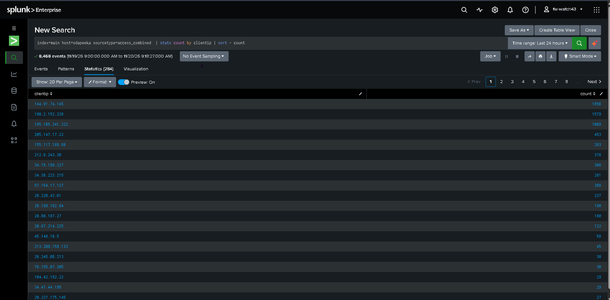
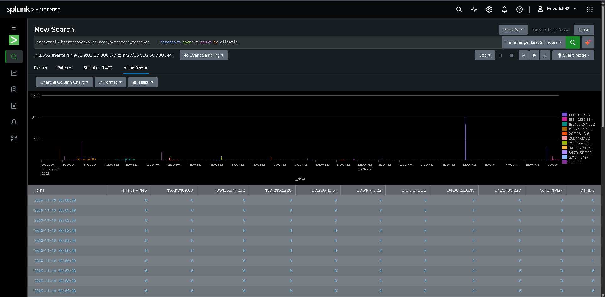
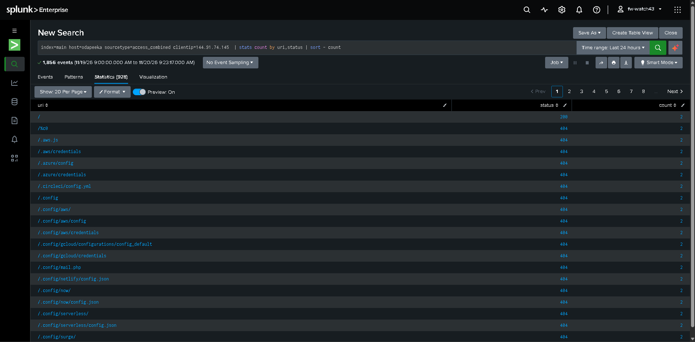
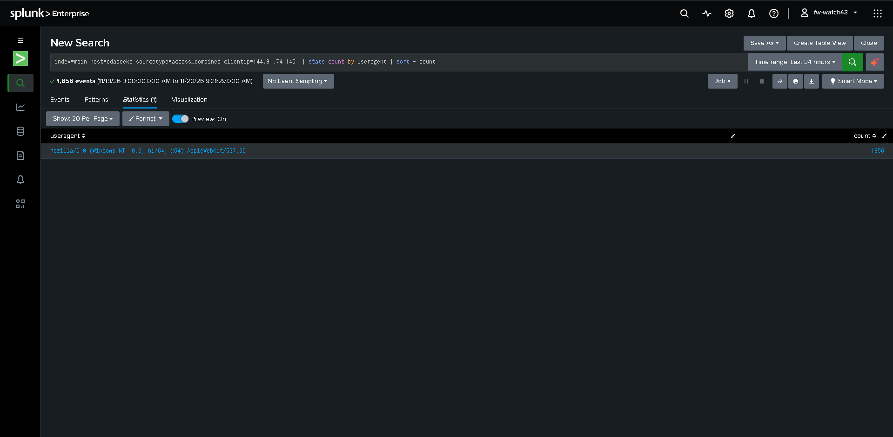

# Cover6 First Watch – Day 1: Reconnaissance

**Incident:** Odapeeka State University  
**Analyst:** Sami Qasem 
**Date:** 20–21 November 2026  
**Source:** Splunk · `index=main` · `host=odapeeka` · `sourcetype=access_combined`  
**Time Range:** Last 24 hours

---

## Executive Summary

The most active client IP **`144.91.74.145`** generated **1,856 events** and performed systematic scanning for sensitive configuration and credential files. Almost all requests returned **HTTP 404**.

---

## Top Client IPs

```spl
index=main host=odapeeka sourcetype=access_combined 
| stats count by clientip 
| sort - count
```



| Rank | Client IP         | Count |
|------|-------------------|-------|
| 1    | 144.91.74.145     | 1856  |
| 2    | 190.2.152.228     | 1579  |
| 3    | 185.165.241.222   | 1059  |
| 4    | 205.147.17.22     | 453   |
| 5    | 155.117.189.88    | 393   |

---

## Temporal Distribution

```spl
index=main host=odapeeka sourcetype=access_combined 
| timechart span=1m count by clientip
```



Clear spikes are visible across the 24-hour window, especially from `144.91.74.145`.

---

## Deep Dive – 144.91.74.145

### Requested URIs & Status Codes

```spl
index=main host=odapeeka sourcetype=access_combined clientip=144.91.74.145 
| stats count by uri,status 
| sort - count
```



- Root path `/` → **200** (2 events)
- All other observed paths (`.aws/credentials`, `.azure/config`, `.config/aws/`, `.config/gcloud/`, `.circleci/config.yml`, `.config/netlify/`, `.config/serverless/`, etc.) → **404**

The IP is actively probing for cloud credentials and configuration files.

### User-Agent

```spl
index=main host=odapeeka sourcetype=access_combined clientip=144.91.74.145 
| stats count by useragent
```



Only one User-Agent was used for all 1,856 requests:

```
Mozilla/5.0 (Windows NT 10.0; Win64; x64) AppleWebKit/537.36
```

---

## Key Findings

- `144.91.74.145` is the highest-volume source.
- Requests target known sensitive paths (AWS, Azure, GCloud, CI/CD configs).
- Almost all responses are **404**.
- Single consistent User-Agent across the entire activity.
- Activity occurred in multiple distinct spikes.

---

## Evidence

| File | Description |
|------|-------------|
| `evidence/01-top-clientips.png` | Top client IPs |
| `evidence/02-timechart-by-clientip.png` | Timechart |
| `evidence/03-uri-status-144.91.74.145.png` | URI + Status |
| `evidence/04-useragent-144.91.74.145.png` | User-Agent |

---

**End of Day 1 Report**
