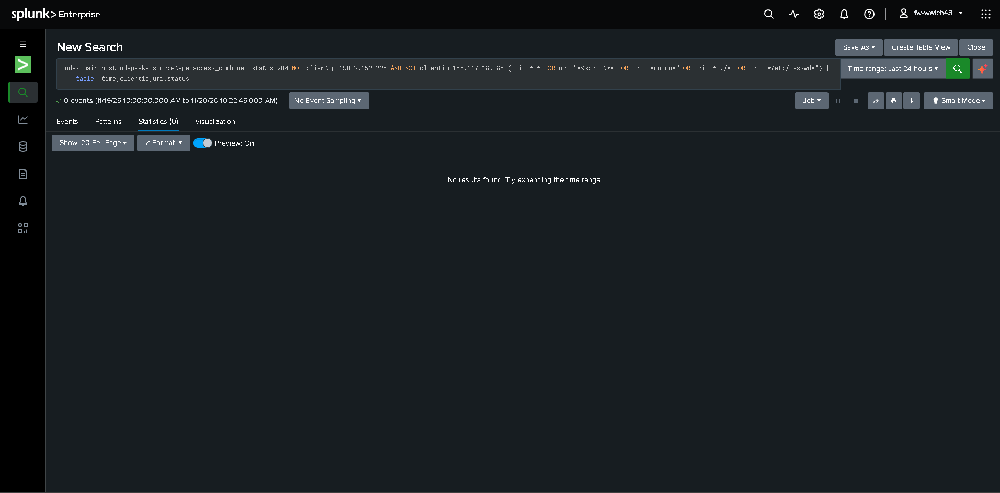
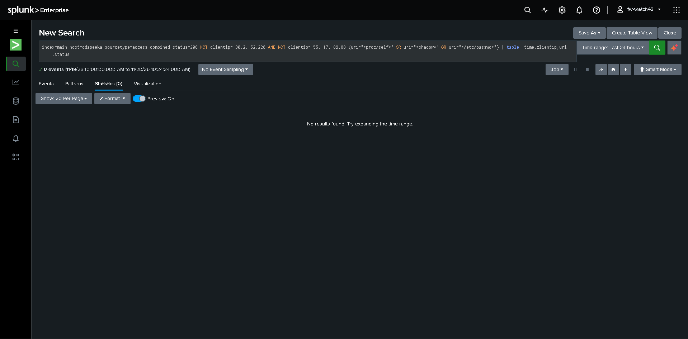
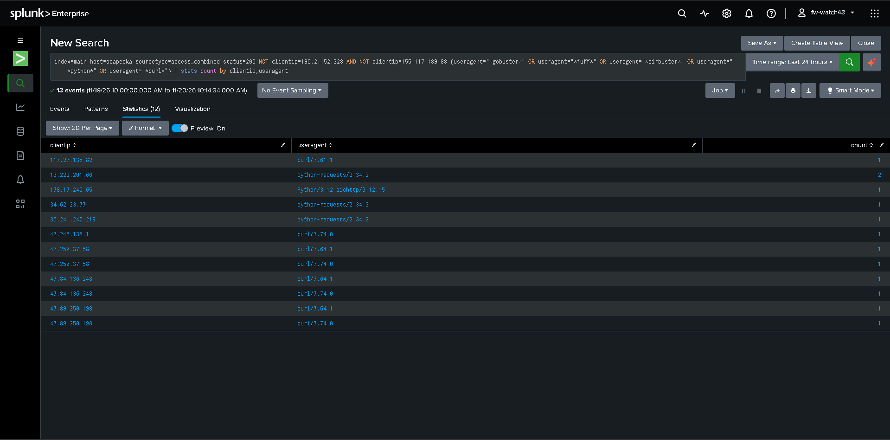
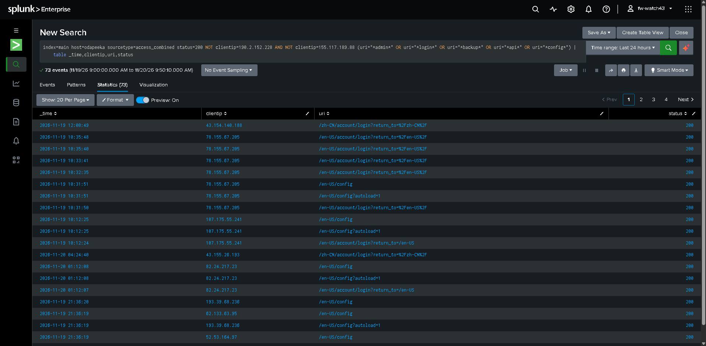

# Cover6 First Watch – Day 2: Web Enumeration

**Incident:** Odapeeka State University  
**Analyst:** Sami Qasem
**Date:** 20–21 November 2026  
**Source:** Splunk · `index=main` · `host=odapeeka` · `sourcetype=access_combined`  
**Time Range:** Last 24 hours  
**Filters applied:** `status=200` AND excluding `190.2.152.228` and `155.117.189.88`

---

## Executive Summary

Web enumeration activity was investigated by searching for common attack patterns, sensitive path access, and known scanning tools.  

- No successful SQL injection, XSS, path traversal, or local file inclusion attempts returned HTTP 200.  
- Multiple requests from automated tools (`curl`, `python-requests`, `aiohttp`) were observed.  
- Legitimate-looking access to `/account/login` and `/config` paths was recorded from several external IPs.

---

## 1. Injection & Path Traversal Checks

### 1.1 Common SQLi / XSS / Path Traversal Patterns

```spl
index=main host=odapeeka sourcetype=access_combined status=200 
NOT clientip=190.2.152.228 AND NOT clientip=155.117.189.88 
(uri="*'*" OR uri="*<script>*" OR uri="*union*" OR uri="*../" OR uri="*/etc/passwd*") 
| table _time,clientip,uri,status
```



**Result:** 0 events

### 1.2 Sensitive File Access (/proc, shadow, passwd)

```spl
index=main host=odapeeka sourcetype=access_combined status=200 
NOT clientip=190.2.152.228 AND NOT clientip=155.117.189.88 
(uri="*/proc/self*" OR uri="*shadow*" OR uri="*/etc/passwd*") 
| table _time,clientip,uri,status
```



**Result:** 0 events

---

## 2. Scanning Tools Detection (User-Agent)

```spl
index=main host=odapeeka sourcetype=access_combined status=200 
NOT clientip=190.2.152.228 AND NOT clientip=155.117.189.88 
(useragent="*gobuster*" OR useragent="*ffuf*" OR useragent="*dirbuster*" OR useragent="*python*" OR useragent="*curl*") 
| stats count by clientip,useragent
```



**Result:** 13 events

| Client IP       | User-Agent                          | Count |
|-----------------|-------------------------------------|-------|
| 117.27.135.82   | curl/7.61.1                         | 1     |
| 13.222.201.60   | python-requests/2.34.2              | 2     |
| 178.17.248.65   | python/3.12 aiohttp/3.12.15         | 1     |
| 34.62.23.77     | python-requests/2.34.2              | 1     |
| 35.241.246.219  | python-requests/2.34.2              | 1     |
| 47.245.138.1    | curl/7.74.0                         | 1     |
| 47.250.37.58    | curl/7.64.1                         | 1     |
| 47.250.37.58    | curl/7.74.0                         | 1     |
| 47.84.136.248   | curl/7.64.1                         | 1     |
| 47.84.136.248   | curl/7.74.0                         | 1     |
| 47.89.250.198   | curl/7.64.1                         | 1     |
| 47.89.250.198   | curl/7.74.0                         | 1     |

Multiple external IPs used `curl` and Python-based HTTP libraries to access the site successfully (status 200).

---

## 3. Sensitive Path Access (Admin / Login / Config)

```spl
index=main host=odapeeka sourcetype=access_combined status=200 
NOT clientip=190.2.152.228 AND NOT clientip=155.117.189.88 
(uri="*admin*" OR uri="*login*" OR uri="*backup*" OR uri="*api*" OR uri="*config*") 
| table _time,clientip,uri,status
```



**Result:** 73 events

Examples of observed successful requests:

| Time                | Client IP       | URI                                              | Status |
|---------------------|-----------------|--------------------------------------------------|--------|
| 2026-11-19 12:00:49 | 43.154.140.188  | /zh-CN/account/login?return_to=%2Fzh-CN%2F       | 200    |
| 2026-11-19 10:25:48 | 78.155.67.205   | /en-US/account/login?return_to=%2Fen-US%2F       | 200    |
| 2026-11-19 10:31:51 | 78.155.67.205   | /en-US/config                                    | 200    |
| 2026-11-19 10:31:51 | 78.155.67.205   | /en-US/config?autoload=1                         | 200    |
| 2026-11-19 10:12:25 | 107.175.55.241  | /en-US/config                                    | 200    |
| 2026-11-20 01:12:08 | 82.24.217.23    | /en-US/config                                    | 200    |
| 2026-11-19 21:36:20 | 193.39.68.236   | /en-US/config                                    | 200    |

Successful access was observed to login pages and configuration endpoints from multiple external IP addresses.

---

## Key Findings

- No evidence of successful SQL injection, XSS, path traversal, or local file inclusion (all related searches returned 0 events).
- Multiple automated tools (`curl`, `python-requests`, `aiohttp`) successfully reached the application (status 200).
- Login and configuration pages (`/account/login`, `/config`) were accessed successfully by several external IPs.
- The two previously high-volume IPs (`190.2.152.228` and `155.117.189.88`) were excluded from this analysis as instructed.

---

## Evidence

| File | Description |
|------|-------------|
| `evidence/01-injection-patterns.png` | SQLi / XSS / Path Traversal search (0 results) |
| `evidence/02-sensitive-files.png` | /proc / shadow / passwd search (0 results) |
| `evidence/03-scanning-tools.png` | User-Agent scanning tools detection |
| `evidence/04-sensitive-paths.png` | Admin / Login / Config successful access |

---

**End of Day 2 Report**
