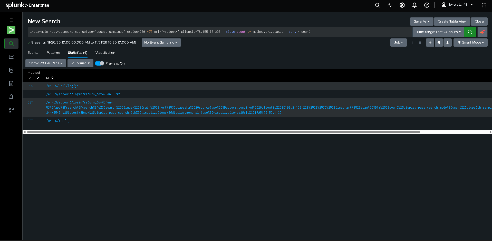
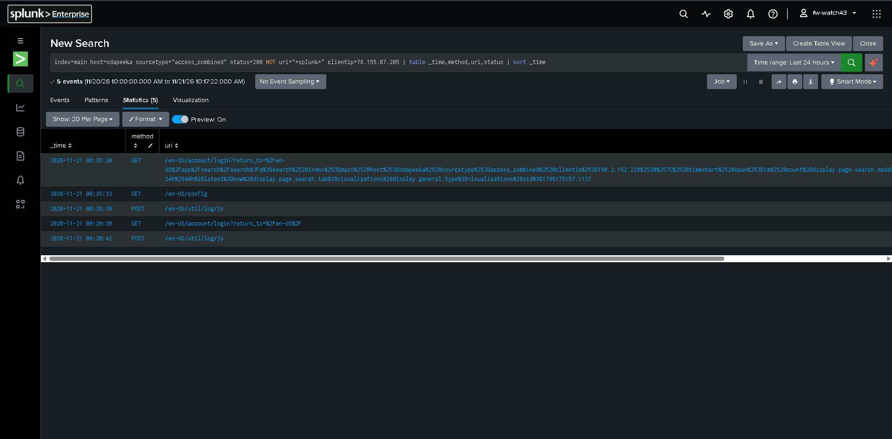
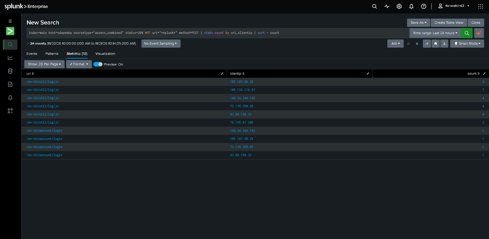
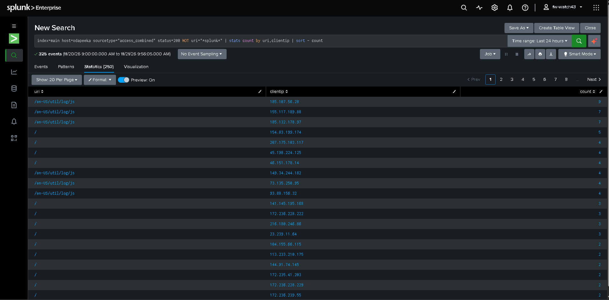
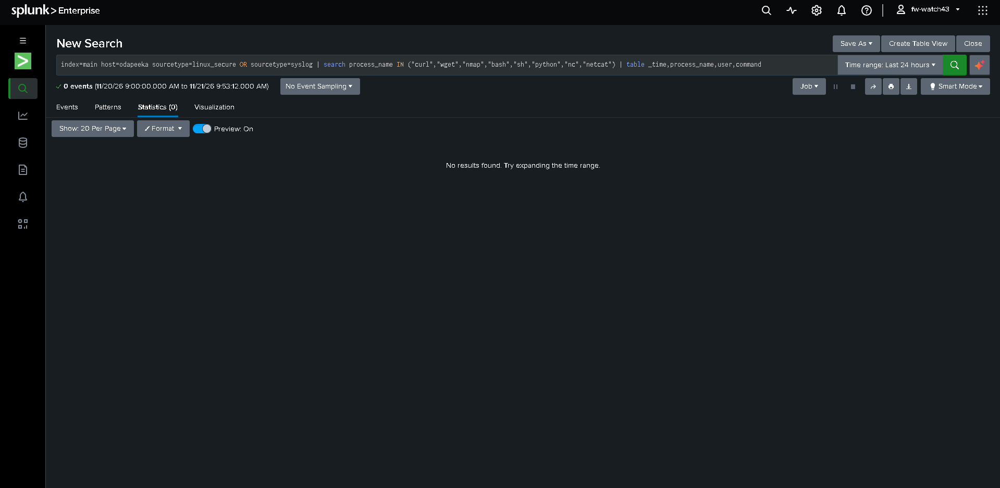
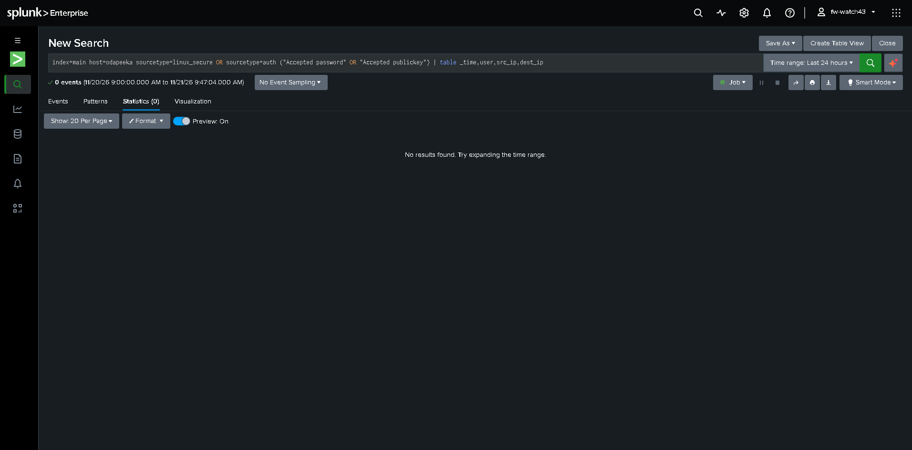

# Cover6 First Watch – Day 3: Initial Access

**Incident:** Odapeeka State University  
**Analyst:** Sami Qasem 
**Date:** 20–21 November 2026  
**Source:** Splunk · `index=main` · `host=odapeeka`  
**Time Range:** Last 24 hours

---

## Executive Summary

Investigation focused on indicators of successful initial access, including web login activity, POST requests, suspicious process execution, and successful SSH authentication.

- Successful access to login and configuration pages was observed from multiple external IPs (notably `78.155.67.205`).
- Multiple POST requests targeted `/en-US/util/log/js`.
- No evidence of successful SSH logins (`Accepted password` / `Accepted publickey`) was found.
- No suspicious processes (`curl`, `wget`, `nmap`, `bash`, `python`, `nc`, `netcat`) were detected in the Linux logs.

---

## 1. Web Activity from 78.155.67.205

```spl
index=main host=odapeeka sourcetype="access_combined" status=200 
NOT uri="*splunk*" clientip=78.155.67.205 
| table _time,method,uri,status 
| sort _time
```



**Observed events (5 total):**

| Time                | Method | URI                                      |
|---------------------|--------|------------------------------------------|
| 2026-11-21 06:35:30 | GET    | /en-US/account/login?return_to=...       |
| 2026-11-21 06:35:33 | GET    | /en-US/config                            |
| 2026-11-21 06:35:39 | POST   | /en-US/util/log/js                       |
| 2026-11-21 09:20:39 | GET    | /en-US/account/login?return_to=...       |
| 2026-11-21 09:20:42 | POST   | /en-US/util/log/js                       |

---

## 2. Summary of Methods & URIs for 78.155.67.205

```spl
index=main host=odapeeka sourcetype="access_combined" status=200 
NOT uri="*splunk*" clientip=78.155.67.205 
| stats count by method,uri,status 
| sort - count
```



Main observed endpoints:
- `POST /en-US/util/log/js`
- `GET /en-US/account/login`
- `GET /en-US/config`

---

## 3. POST Requests Overview

```spl
index=main host=odapeeka sourcetype="access_combined" status=200 
NOT uri="*splunk*" method=POST 
| stats count by uri,clientip 
| sort - count
```



Top POST targets:

| URI                    | Client IP       | Count |
|------------------------|-----------------|-------|
| /en-US/util/log/js     | 185.107.56.28   | 8     |
| /en-US/util/log/js     | 185.132.178.97  | 7     |
| /en-US/util/log/js     | 149.34.244.182  | 4     |
| /en-US/util/log/js     | 73.135.250.95   | 4     |
| /en-US/util/log/js     | 93.88.156.32    | 4     |
| /en-US/util/log/js     | 78.155.67.205   | 2     |
| /en-US/account/login   | Multiple IPs    | 1 each|

---

## 4. Overall Successful Web Access (status=200)

```spl
index=main host=odapeeka sourcetype="access_combined" status=200 
NOT uri="*splunk*" 
| stats count by uri,clientip 
| sort - count
```



Highest activity observed on `/en-US/util/log/js` from several external IPs, followed by root path (`/`) and other pages.

---

## 5. Suspicious Process Execution Check

```spl
index=main host=odapeeka sourcetype=linux_secure OR sourcetype=syslog 
| search process_name IN ("curl","wget","nmap","bash","sh","python","nc","netcat") 
| table _time,process_name,user,command
```



**Result:** 0 events

---

## 6. Successful SSH Authentication Check

```spl
index=main host=odapeeka sourcetype=linux_secure OR sourcetype=auth 
("Accepted password" OR "Accepted publickey") 
| table _time,user,src_ip,dest_ip
```



**Result:** 0 events

---

## Key Findings

- Multiple external IPs (including `78.155.67.205`) successfully accessed login and configuration pages.
- Significant POST activity targeted `/en-US/util/log/js`.
- No successful SSH authentications were found in the available logs.
- No execution of common post-exploitation or scanning tools (`curl`, `wget`, `nmap`, `python`, `nc`, etc.) was detected.
- At this stage, there is **web interaction** with login/config endpoints, but **no confirmed successful initial access** via SSH or clear post-exploitation activity in the host logs.

---

## Evidence

| File | Description |
|------|-------------|
| `evidence/01-78.155.67.205-activity.png` | Timeline of activity from 78.155.67.205 |
| `evidence/02-method-uri-summary.png` | Method + URI summary for 78.155.67.205 |
| `evidence/03-post-requests.png` | POST requests by URI and clientip |
| `evidence/04-top-successful-uris.png` | Top successful URIs and clientips |
| `evidence/05-suspicious-processes.png` | Suspicious process search (0 results) |
| `evidence/06-successful-ssh.png` | Successful SSH login search (0 results) |

---

**End of Day 3 Report**
